<p align="center">
  
</p>

<p align="center">
  
</p>

<p align="center">
  
  
  
  
</p>

## Overview

A JavaFX desktop application for urban transport management, connected to MySQL through JDBC. It covers user administration, transport and vehicle management, and a rating system, with a structured MVC layout.

## Highlights

- JavaFX interface with a structured MVC architecture
- MySQL persistence through JDBC
- User and transport management screens
- Vehicle CRUD operations
- Ratings module with SQL schema included

## Tech stack

<p align="center">
  
</p>

## Getting started

**Prerequisites:** JDK 17+, MySQL and Maven.

```bash
mysql -u root -p < users(1).sql
mysql -u root -p < ratings.sql
# update the JDBC URL and credentials in the project config
./mvnw javafx:run
```

## Documentation

- [Original project documentation](docs/README_ORIGINAL.md)

---

<p align="center">
  
</p>

<p align="center">
  Built by <a href="https://github.com/Skander-Bardaoui"><b>Skander Bardaoui</b></a> ·
  <a href="https://skander-bardaoui.netlify.app/">Portfolio</a> ·
  <a href="https://github.com/Skander-Bardaoui?tab=repositories">All repositories</a>
</p>
